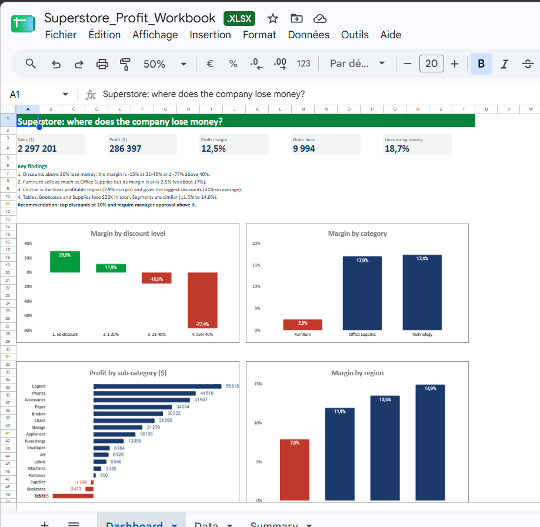
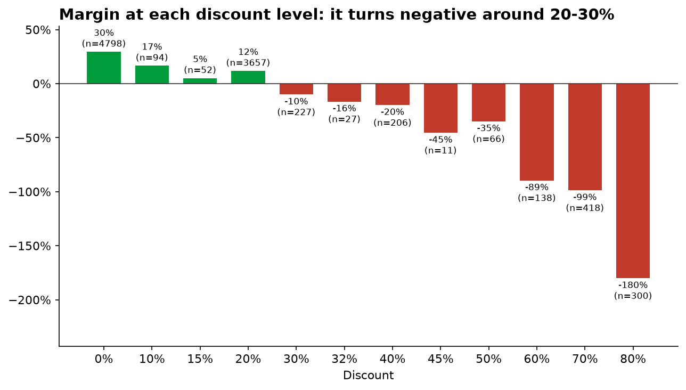
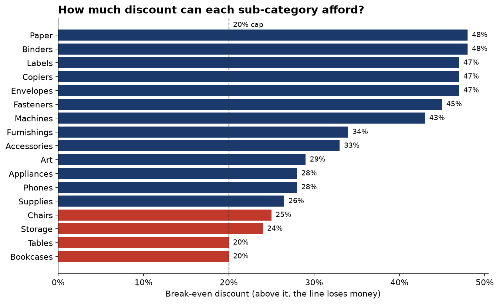

# Superstore Profit Analysis: Where Does the Company Lose Money?

**A retailer sold $2.3M over four years, but where does the profit leak?**
An analysis of 9,994 order lines (2014-2017) with SQL, Python (regression) and an Excel / Google Sheets dashboard. The main finding: **discounts above 20% lose money, and they do not sell more units**.



## Key findings

| # | Finding | Evidence |
|---|---|---|
| 1 | **Discounts above 20% lose money.** | Margin is **+29.5%** with no discount, +11.9% at 1-20%, **-15.3%** at 21-40% and **-77.4%** above 40%. The 1,393 lines above 20% (14% of all lines) lost **$135,376**. |
| 2 | **Furniture sells a lot but earns little.** | Furniture sales are $742K (more than Office Supplies at $719K) but its margin is **2.5%**, against 17.0% for Office Supplies and 17.4% for Technology. |
| 3 | **Central is the weakest region, and it discounts the most.** | Central margin is **7.9%** with a 24.0% average discount. West has the best margin (14.9%) with the lowest average discount (10.9%). |
| 4 | **Three sub-categories lose money.** | Tables (-$17,725), Bookcases (-$3,473) and Supplies (-$1,189), **-$22,387** in total. 55% of Tables lines carry a discount above 20%. |
| 5 | **Customer segments are similar.** | Margins range from 11.5% (Consumer) to 14.0% (Home Office), a small gap compared with the discount effect. |

Overall: sales $2,297,201, profit $286,397, margin 12.5%. **18.7% of order lines lose money.**

## Going further with Python: do discounts really cause the losses?

The SQL step shows an association. Five sharper questions were answered in [`src/discount_analysis.py`](src/discount_analysis.py):

| # | Question | Answer |
|---|---|---|
| 1 | How much margin does a bigger discount cost, holding product, region and segment constant? | **+10 points of discount lowers the line margin by about 20 points** (95% CI -20.4 to -19.6 points; OLS with robust standard errors, R² = 0.82). |
| 2 | Do discounts bring more volume? | **No.** Average units per order line: 3.81 with no discount, 3.74 at 1-20%, 3.78 at 21-40%, 3.90 above 40% (no significant link, p = 0.94). Discounts reduce margin without lifting units per line. |
| 3 | What discount can each sub-category afford? | The break-even discount (where margin hits zero) is only **20% for Tables and Bookcases**, 24% for Storage and 25% for Chairs, but up to 48% for Paper and Binders. |
| 4 | Is Central still worse after accounting for discounts? | Central's margin gap versus the other regions **shrinks by 70% to 81%** once its discounts are accounted for. |
| 5 | Why does Supplies lose money without big discounts? | 11 of 36 Supplies products lose money. The worst two (electric letter openers) cost **about 97% of their full price**, so they have almost no margin even before any discount. They make 82% of the losses of the loss-making products. |





## Recommendations

1. **Cap discounts at 20% company-wide and require manager approval above it**, and use a **lower cap (about 10%) on Tables, Bookcases, Storage and Chairs**, whose break-even discount is only 20% to 25%. Discounts do not increase units per line, so they cost margin without a visible volume benefit.
2. **Review the Tables pricing and discount policy**: it is the largest single loss, over half of its lines are heavily discounted and its break-even discount is exactly 20%.
3. **Reprice the Supplies letter openers.** Their cost is about 97% of the full price, so this is a pricing problem, not a discount problem.
4. **Review discount rules in the Central region**, where average discounts are more than double those of the West and account for most of its margin gap.

## Limitations (what this analysis cannot say)

- **Association is not causation.** The regression holds product, region and segment constant, but it cannot exclude other factors (for example, managers may discount products that are already unprofitable). Discounts are the strongest suspect, not a proven cause.
- **The break-even discounts assume a constant unit cost** within a sub-category, with cost taken as sales minus profit (no cost detail is available).
- **The volume check covers units per order line only.** It cannot show whether discounts attract new customers or extra orders.
- This is a **public sample dataset**, so the findings illustrate a method rather than describe a real company.
- Profit is taken as given. The data has no detail on costs, shipping or returns.
- Four years only (2014-2017), one country, amounts in US dollars.

## How the analysis was done

| Stage | What was done | Where |
|---|---|---|
| Business understanding | One question: where is profit lost? Four sub-questions (category, region, discount, segment). | this README |
| Data audit | 9,994 rows, 21 columns, **0 missing values**, 0 duplicate IDs. Two traps found and fixed: the file is **not UTF-8** (read as latin-1) and dates are in **US format** (month/day/year). | [`load_data.py`](load_data.py) |
| SQL analysis | `GROUP BY`, `CASE WHEN` discount buckets, `HAVING`, margin calculation | [`sql/analysis.sql`](sql/analysis.sql) |
| Python analysis | Regression with robust standard errors, volume check, break-even discounts, region gap, product drill-down | [`src/discount_analysis.py`](src/discount_analysis.py) |
| Excel / Google Sheets | 3 sheets: data, `SUMIFS` summary, dashboard with 4 charts | [`excel/`](excel/) |
| Cross-check | All 31 summary rows were checked against the SQL results: no difference | [`excel/build_workbook.py`](excel/build_workbook.py) |
| Insights | Findings, recommendations and limitations | this README, [`reports/executive_summary.md`](reports/executive_summary.md) |

### A lesson from this project
When the first spreadsheet import was done in a French-locale Google Sheet, the decimal points were read as text and the totals were wrong (billions instead of $286K). The mistake was caught only because the result was **compared with SQL**. Always cross-check an analysis with a second tool.

## Reproduce it

1. Download the data from [Kaggle: Superstore Dataset](https://www.kaggle.com/datasets/vivek468/superstore-dataset-final) and put `Sample - Superstore.csv` in `data/`.
2. Install the libraries: `pip install -r requirements.txt`
3. Run:

```bash
python load_data.py              # CSV -> data/superstore.db (SQLite)
python src/discount_analysis.py  # regression, break-even discounts, charts, tables
python excel/build_workbook.py   # regenerates the Excel workbook
```

Then run the queries of `sql/analysis.sql` in any SQLite tool (for example DB Browser for SQLite) against `data/superstore.db`.

## Project structure

```
02-superstore-profit-analysis/
├── load_data.py          CSV -> SQLite (handles encoding and date format)
├── sql/analysis.sql      the business questions in SQL
├── src/                  Python analysis (regression, break-even discounts)
├── excel/                Excel workbook (data, formulas, dashboard) and its build script
├── reports/              executive summary, charts, result tables
└── requirements.txt
```

**Tools:** SQL (SQLite), Python (pandas, statsmodels, matplotlib), Excel / Google Sheets (SUMIFS, charts).

**Author:** Hadil Ziane, MSc Statistics & Economic Foresight (ENSSEA).
